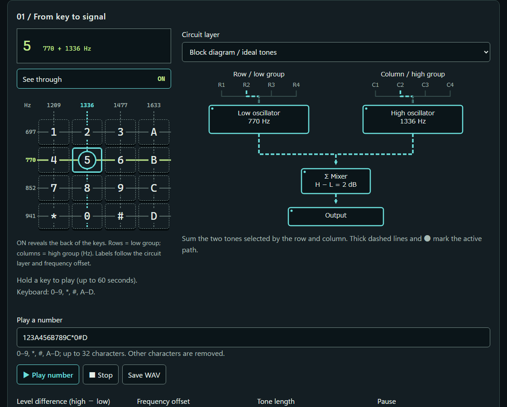
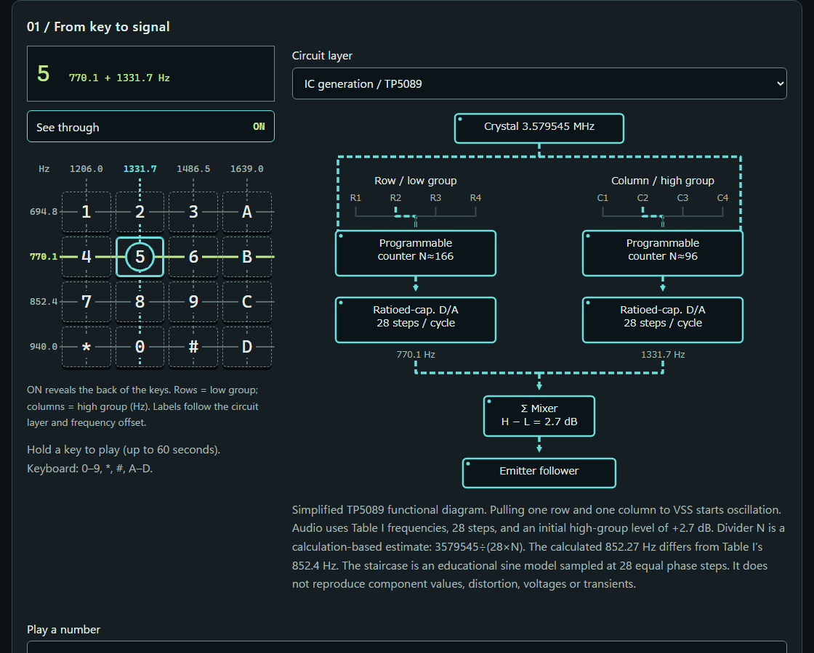
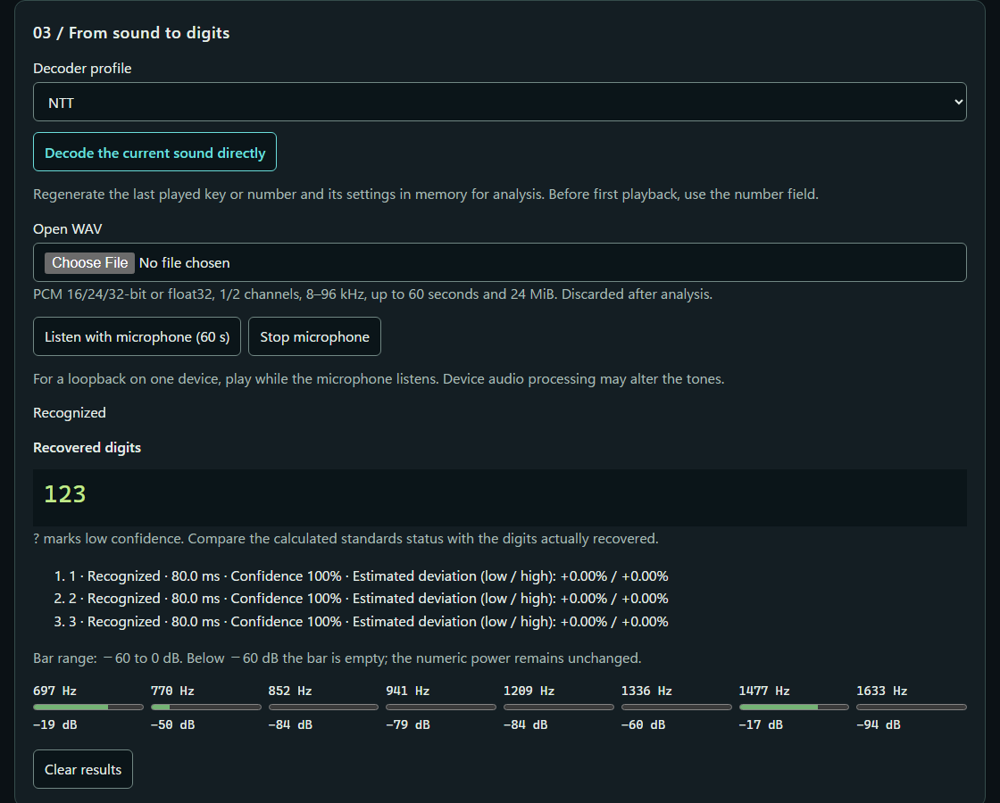
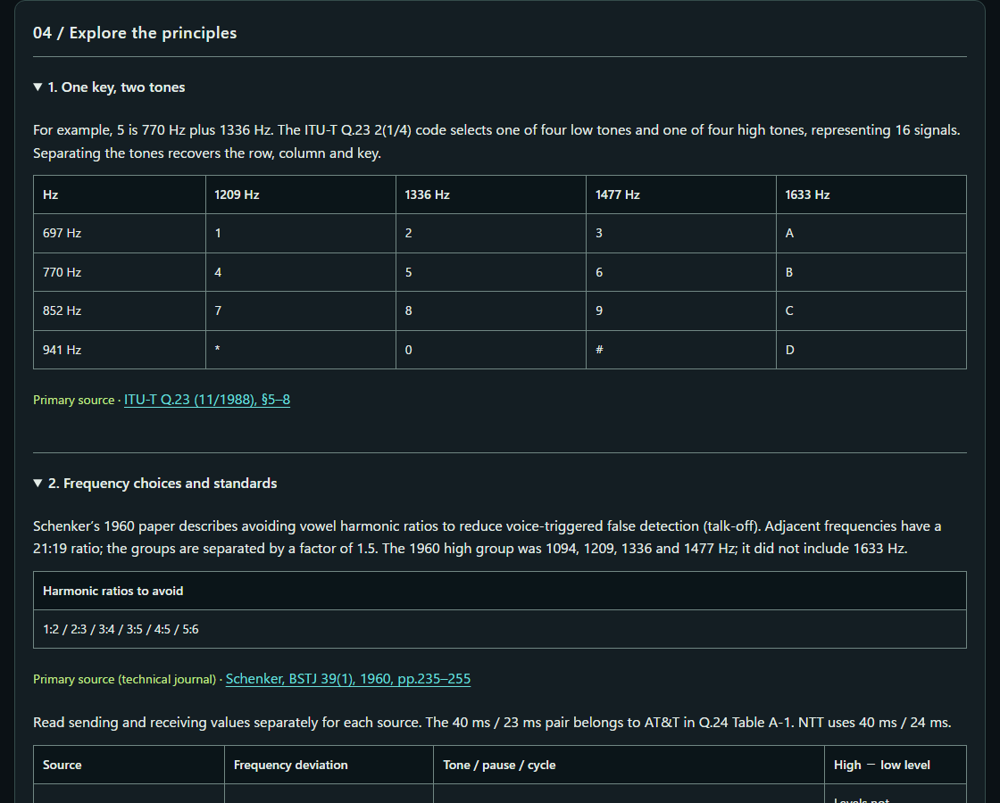

<!--
---
id: day121
slug: dtmfusion

title: "DTMFusion"

subtitle_ja: "電話の音を鳴らし、回路で見て、番号へ戻す"
subtitle_en: "Play telephone tones, trace the circuit, recover the digits"

description_ja: "DTMFの2音を透かし回路・波形・Goertzel解析で学ぶ教材。理想波とTP5089の教育用モデル、規格別の周波数偏差判定を備えます。"
description_en: "Learn DTMF through transparent circuits, waveforms and Goertzel analysis, with ideal tones, a TP5089 teaching model and frequency-offset decisions."

category_ja:
  - 通信技術
  - プライバシー
category_en:
  - Communication Technologies
  - Privacy

difficulty: 2

tags:
  - dtmf
  - goertzel
  - web-audio
  - side-channel
  - electronics

repo_url: "https://github.com/ipusiron/dtmfusion"
demo_url: "https://ipusiron.github.io/dtmfusion/"

hub: true
---
-->

# DTMFusion - Play telephone tones, trace the circuit, recover the digits


[](https://ipusiron.github.io/dtmfusion/)

**Day121 - Security Tools 200 Built with Generative AI**

DTMFusion is an educational tool for playing a telephone key as two tones, tracing their circuit paths, and recovering the digits from sound.
Switch between ideal tones and a TP5089 teaching model, and compare source-specific limits with the decoder's decisions.
The lessons also explain the acoustic side channel created when tones remain in a recording.

[日本語](README.md) / English

## 🌐 Demo

👉 **[Open DTMFusion](https://ipusiron.github.io/dtmfusion/)**

No installation is needed. You can also save the files and open `index.html` directly.
Microphone access requires browser permission. HTTPS or localhost is recommended; microphone behavior on `file://` varies by browser.
Lower the device volume before playing tones, and consider nearby people and pets.

## 📸 Screenshots



Thick dashed paths and dots identify the selected signal route.



The IC layer distinguishes Table I frequencies from estimated divider values.



Results include digits, reasons, and estimated low/high frequency deviations.



Six lessons distinguish primary evidence, calculations, and secondary accounts.
Light versions: [block](assets/block-en-light.png) / [IC](assets/ic-en-light.png) / [decode](assets/decode-en-light.png) / [lessons](assets/lesson-en-light.png). Japanese screenshots appear in the [Japanese README](README.md#-スクリーンショット).

## ✨ Features

- Sixteen keys in a 4×4 matrix; screen and keyboard input plays while held, for up to 60 seconds
- See through ON/OFF: frequency-labeled rows and columns behind the keys, with the active pair and intersection highlighted
- Sequences of up to 32 characters; defaults of 80 ms tone, 60 ms pause, and high group +2 dB
- Level difference −10 to +10 dB, frequency offset −5 to +5%, and tone/pause lengths 10–200 ms
- Two circuit layers, waveform, spectrum, and enlarged 28-step IC waveform
- Three decoder inputs: regenerate the last tone, load a WAV, or use the microphone; NTT/AT&T profiles
- Estimated frequency offset, `?` for boundaries, rejection reasons, and eight power meters
- Explicit WAV export, Japanese/English, dark/light themes, and reduced motion

On the first visit, the theme follows the device color preference. A saved theme takes priority over the device setting.

Held keys play a short loop: one second for ideal tones at 0% offset, or 0.5–2 seconds for IC tones and frequency offsets. The chosen length minimizes the two phase errors among joins whose sample discontinuity does not exceed an interior sample step. Preparation runs in small chunks on the first interaction and after settings change; buffers are reused by key, settings, and sample rate. The first press includes audio startup and preparation. Attack/release fades, the −12 dBFS ceiling, and the 60-second automatic stop remain in place.

## 📐 Screen layout

The page proceeds from key and circuit to waveform/spectrum, decoding, and lessons. On narrow screens the circuit appears below the keypad.
Use the See through button above the keypad. It starts ON: four horizontal lines represent the low group and four vertical lines the high group.
Frequency labels follow the ideal/IC layer and frequency offset. OFF restores the normal keypad while the circuit diagram remains visible.
Both states reserve the frequency-label margins. Toggling preserves all sixteen key positions, dimensions, gaps, and the outer keypad height.
Waveform and spectrum are previews generated from the selected key and settings, not microphone measurements. The waveform spans 12 ms and the spectrum 600–1750 Hz.
Use the decoder's power meters and decisions to inspect microphone or WAV analysis.
Power bars use a fixed −60 to 0 dB range. Below −60 dB the bar is empty; the adjacent numeric dB value is preserved.

## 📖 Usage

1. Hold key 5 and follow its 770 Hz and 1336 Hz paths. Release it to stop the tone.
2. Select the IC layer and follow the crystal, counters, converters, and mixer. The initial level difference changes to +2.7 dB.
3. Enter a sequence. Input other than 0–9, A–D, * and # is removed as you type.
4. Adjust the controls and inspect the source-specific limits. Direct decoding regenerates the most recently played key or sequence with its settings; before any playback it uses the input field.
5. Load a WAV or start the microphone. Microphone analysis stops after 60 seconds and releases resources on stop, page exit, or input interruption.
6. Save the current sequence as a PCM 16-bit WAV with the export button. Saving is never automatic.

WAV input supports PCM 16/24/32-bit or float32, one or two channels, 8–96 kHz, at most 60 seconds and 24 MiB. Stereo channels are averaged.
Loaded audio is released after decoding. Microphone samples pass through a short analysis window and are discarded; only displayed decisions remain.

## 🎯 Use cases

Ways of using this tool in particular

- In an information theory class, trace key 5 backward from 770 Hz + 1336 Hz (E1). Eight frequencies encode 4×4 = 16 combinations. This is not a voice classifier.
- Electronics learners can change ideal key 5 into the IC model's 770.1 Hz + 1331.7 Hz (E2), separating nominal values, Table I values, and divider estimates. This is not a transistor or voltage simulation.
- For a quality-control lesson, compare key 5 at +2%, which yields `?` (E3), with +3%, which is rejected (E4). This separates a specified boundary from an estimated measurement; it is not product certification.
- Puzzle designers can export `123` to WAV and recover the same sequence to demonstrate sound as symbols. The encoding does not keep the digits secret.

The tool also supports classroom or home study, research into older electronics, and discussion of information retained in recordings.
Microphone results depend on the room, speakers, and device audio processing.

These examples use 48 kHz, 80 ms tones, and 60 ms pauses. `—` means rejection without appending a digit. Tests recalculate both language versions.

| ID | mode | profile | key | offset % | twist dB | low Hz | high Hz | result |
|---|---|---|---|---|---|---|---|---|
| E1 | ideal | NTT | 5 | 0 | 2 | 770 | 1336 | 5 |
| E2 | ic | NTT | 5 | 0 | 2.7 | 770.1 | 1331.7 | 5 |
| E3 | ideal | NTT | 5 | 2 | 2 | 785.4 | 1362.72 | ? |
| E4 | ideal | NTT | 5 | 3 | 2 | 793.1 | 1376.08 | — |

## 🔬 Standards and measurements

Sending and receiving requirements are separate. The 40 ms / 23 ms values belong to the AT&T column of Q.24 Table A-1, not a universal ITU-T requirement.
Level difference means high minus low. This table covers the parameters used here, not every requirement in each source.

| Source | Frequency deviation | Tone duration | Pause | Cycle | Level difference |
|---|---|---|---|---|---|
| Q.23 / sender | ≤1.8% | Not specified | Not specified | Not specified | Not standardized |
| Q.24 A-1 / NTT receiver | Operate≤1.8%, reject≥3.0% | Operate≥40ms, reject≤24ms | ≥30ms | ≥120ms | −5…+5dB |
| Q.24 A-1 / AT&T receiver | Operate≤1.5%, reject≥3.5% | Operate≥40ms, reject≤23ms | ≥40ms | ≥93ms | −8…+4dB |
| NTT reference / terminal sender | ≤1.5% | ≥50ms | ≥30ms | ≥120ms | 0…+5dB |

Sources: [Q.23 (1988)](https://www.itu.int/rec/T-REC-Q.23-198811-I/en), [Q.24 (1988), Annex A](https://www.itu.int/rec/T-REC-Q.24-198811-I/en), and [NTT East v6.2 (July 2025), p.14](https://flets.com/denwa/gisanshi/pdf/analog_gisanshi.pdf). The NTT terminal table excludes the 1633 Hz column.

Analysis uses a 25.6 ms Hann window and exact-frequency Goertzel coefficients, without rounding to integer bins. Candidates selected from eight nominal frequencies are rescanned at 17 points over ±4% in 0.5% increments.
Log-power interpolation estimates each peak. Windows for the same key are averaged, and deviation decisions are rounded to 0.01%. This is the display/decision increment, not an accuracy guarantee.
Estimated peak power must be at least six times the nominal runner-up in each group. Estimated level difference is rounded to 0.1 dB.

| rate Hz | N | rate/N Hz |
|---|---|---|
| 8000 | 205 | 39.02 |
| 44100 | 1129 | 39.06 |
| 48000 | 1229 | 39.06 |

At 48 kHz, across all 16 keys at zero added offset, minimum dominance ratios were ideal/IC 27.11/27.10 with 20 ms windows, 1293.56/1261.38 with 25.6 ms, and 1413.24/1295.65 with 32 ms.
The 25.6 ms window was selected; threshold 6 leaves room for windows near tone edges and interruptions. This teaching setting does not guarantee a false-positive rate for arbitrary audio.

Synthetic measurements on 2026-10-21 gave the ranges below. Results were identical at 8, 44.1, and 48 kHz.
The axis is the offset added by the control. IC Table I frequencies already differ from nominal, so the control value is not the total standards deviation.

| mode | profile | All 16 keys accepted (%) | At least one key accepted (%) |
|---|---|---|---|
| ideal | NTT | -1.8 … +1.8 | -1.8 … +1.8 |
| ideal | ATT | -1.5 … +1.5 | -1.5 … +1.5 |
| ic | NTT | -1.4 … +1.1 | -1.8 … +2.1 |
| ic | ATT | -1.1 … +0.8 | -1.5 … +1.8 |

The ±5% sweep at 0.1% increments covered 16 keys × 2 waveforms × 2 profiles × 3 rates: 19,392 inputs and zero wrong-key outputs.
An absolute estimated deviation of at least 3.0% (NTT) or 3.5% (AT&T) is rejected as frequency offset. Above 1.8% / 1.5% and below the corresponding rejection limit, the result is the boundary symbol `?`.
Regression tests cover the exact operation and rejection limits and adjacent 0.1% points for all 16 ideal keys at all three rates.
See the [measurement data](docs/measurements.json). Receiver cycle time and second-harmonic checks against voice false positives are not implemented.
The standards panel calculates from control settings; the decoder estimates from sound. They are separate decisions.

## ☎️ Telephone sets and DTMF

Dial-pulse service represents digits by interrupting line current a counted number of times.
Push-button signaling uses DTMF: one low-group tone and one high-group tone for each symbol.
When PB signaling is sent over an analog subscriber line, the tones themselves travel along the line.
The primary source, [NTT West's technical reference v6.2, Tables 3.3.6 and 3.3.7](https://www.ntt-west.co.jp/gisanshi/analog/pdf/analog_gisanshi_06_02.pdf), specifies DP and PB separately.

Mobile, VoLTE, and IP telephony often carry a digit as an event and regenerate the tone at the receiving side.
Circuit-switched mobile telephony uses START DTMF / STOP DTMF signaling, while VoLTE MTSI supports RFC 4733 telephone-event.
These 3GPP descriptions come from copies of [TS 24.008 §5.5.7.2](https://itecspec.com/3gpp/24.008/s/5.5.7.2) and [TS 26.114 Annex G.3](https://itecspec.com/3gpp/26.114/s/g.3), treated here as secondary sources.
The primary source [RFC 4733 §1.2](https://www.rfc-editor.org/rfc/rfc4733) explains that low-bitrate voice codecs cannot always reproduce DTMF faithfully enough for detection.
The sound retained in a recording and the digit transported by the network can therefore be different representations.

## 🕰️ History of DTMF

DTMF developed through frequency-code design, telephone-service deployment, and integration into electronic circuits.
The dates below retain the distinctions between sources and their evidence strength.

| Period | Development and context | Evidence |
|---|---|---|
| 1960 | Schenker described a two-group code avoiding vowel harmonic ratios, with adjacent ratio 21:19 and inter-group factor 1.5. Its high group was 1094/1209/1336/1477 Hz, without 1633 Hz. | [Original paper](https://www.repeater-builder.com/tech-info/dtmf/pdfs/bstj-39-01-pages-235-255.pdf): primary source |
| November 18, 1963 | Commercial Touch-Tone service began in Carnegie and Greensburg, Pennsylvania, with ten-button sets for subscribers paying an additional charge. | [Hagley Museum](https://hagley.org/research/news/hagley-vault/date-november-18-1963-bell-telephone-began-offering-worlds-first): public museum source |
| Often dated to 1968 | The twelve-button Western Electric 2500 added * and #. Some accounts give 1969, so the year is not treated as settled. | [Push-button telephone](https://en.wikipedia.org/wiki/Push-button_telephone): secondary source |
| 1968 article | AUTOVON's FO, F, I, and P priority buttons were described. Their association with the 1633 Hz column comes from secondary accounts. | [Bell Labs Record](https://www.telephonecollectors.info/index.php/browse/document-repository/catalogs-manuals/bell-system-we/bell-labs-record/11826-68apr-blr-p106-autovon/file): primary source / [Crypto Museum](https://www.cryptomuseum.com/phone/autovon/index.htm): secondary source for the association |
| Around 1969 | Japan's 600P Push Phone appeared. Sources describe different milestones such as sales, naming, and mass production; no exact month or day is assigned here. | [NTT East data book](https://www.ntt-east.co.jp/databook/pdf/2024_S4.pdf) and [NTT History Center](https://hct.rd.ntt/panel/pdf/2_F_2_1_1.pdf): primary sources |
| Dedicated-IC era | The TP5089 uses a crystal reference, counters, ratioed-capacitor converters, and a mixer to generate and combine the tones. | [TP5089 datasheet](https://pf.unikeyic.com/datasheet/43/7d/d1e0/437dd1e00336b1f0b5169f5d864a3432.pdf): primary-source mirror |

The primary source [ITU-T Q.23](https://www.itu.int/rec/T-REC-Q.23-198811-I/en) defines sixteen signals: ten digits and six additional symbols.
An ordinary twelve-key phone and this tool's sixteen-key matrix including A–D share the same two-group principle.

## 📞 Can DTMF still be used for calls?

DTMF remains in use for telephone operations.
NTT migrated its fixed-line exchange network to IP in January 2024, but its July 2025 technical reference still specifies reception of both DP and PB at the metallic subscriber interface.
The internal network's use of IP and the subscriber telephone's signaling method are separate questions.
Primary sources: [NTT East's IP migration notice](https://www.ntt-east.co.jp/info/detail/231214_01.html) and [NTT West's technical reference v6.2](https://www.ntt-west.co.jp/gisanshi/analog/pdf/analog_gisanshi_06_02.pdf).

After a call connects, automated voice menus still use numbered-button input.
The [Kyoto Prefectural Police notice](https://www.pref.kyoto.jp/fukei/jidouonsei2.html), a public authority source, describes numbered options and waiting for assistance when using a dial telephone.
On dial-pulse service, a compatible telephone may send PB after connection by switching to its Tone mode or following the service's instructions.
Primary-source examples appear in the [Sharp FAQ](https://cs.sharp.co.jp/faq/qa?qid=119212) and [NTT East's 171 guidance](https://www.ntt-east.co.jp/akita/information/detail/pdf/100519.pdf).

The next transition replaces metallic access with fiber-based or wireless fixed-line services.
The primary-source [NTT West announcement of September 29, 2025](https://www.ntt-west.co.jp/news/2509/250929a.html) describes migration by around 2035.
Some telephone sets may become unusable with wireless fixed-line service, so continued compatibility must be checked against the destination service's guidance.

## 🧩 Applications

DTMF can convey short symbols to equipment as well as entered telephone digits.
The evidence differs by application.

| Application | Role of DTMF | Evidence |
|---|---|---|
| Automated voice menus and voicemail | Selecting menus or functions | [Kyoto Prefectural Police](https://www.pref.kyoto.jp/fukei/jidouonsei2.html) provides a numbered-menu example: public authority source |
| Alarm reporting | Contact ID represents alarm information with tones | [SIA DC-05](https://www.securityindustry.org/industry-standards/dc-05-2016/): industry-association description; the research verified a search excerpt, not the page body |
| Broadcast cue tones | Signals local advertisement insertion; migration to SCTE-35 has also been documented | [Cue tone](https://en.wikipedia.org/wiki/Cue_tone): secondary source / [TSL deployment account](https://tslproducts.com/news/dnf-upgrades-news-12-to-scte-content-management/): vendor source |
| Amateur-radio repeater remote control | Represents configuration commands on a control link | [repeater-builder explanation](https://www.repeater-builder.com/voip/pdf/remote-allstar-node.pdf): secondary source |
| Caller identification on some networks | Notifies the calling number on networks that had already adopted DTMF signaling | [ETSI EN 300 659-1](https://www.etsi.org/deliver/etsi_en/300600_300699/30065901/01.03.01_60/en_30065901v010301p.pdf): public standard; the research verified a search excerpt concerning its annex |

Japan's Number Display service uses FSK conforming to ITU-T V.23, not DTMF.
The primary source [NTT West technical reference, Table 4.2.3, p.65](https://www.ntt-west.co.jp/gisanshi/analog/pdf/analog_gisanshi_06_02.pdf) specifies 1200 bit/s, a 1300 Hz mark, and a 2100 Hz space.
The function of conveying a number does not make FSK and DTMF the same signaling method.

## 🔊 Potential for covert channels across air gaps

Physically disconnecting a network can still leave a path for information where sound can travel.
DTMF provides an audible way to study that possibility through the correspondence between tones and symbols.
It is poorly suited to secret communication because it is audible and its specification is public.
Anyone able to receive the tones can use the public mapping to recover the keys; DTMF itself provides no encryption.

Using all sixteen symbols gives `log2(16) = 4` bits per key.
The following are calculated upper bounds assuming one key per cycle, not measured transfer rates.
The Japanese-period row also assumes sixteen signals for comparison; it does not mean Japan's twelve-key terminal specification encodes four bits per key.

| Cycle reference | Bits per key | Cycle ms | Calculated bit/s | Approx. bit/s |
|---|---|---|---|---|
| AT&T | 4 | 93 | 43.01 | 43 |
| Japan / NTT | 4 | 120 | 33.33 | 33 |

The calculation is `4 / (cycle ms / 1000)`. It excludes synchronization, error-handling overhead, and failures caused by the acoustic environment.
Primary sources: [Q.23's sixteen signals](https://www.itu.int/rec/T-REC-Q.23-198811-I/en), [Q.24 Table A-1's cycles](https://www.itu.int/rec/T-REC-Q.24-198811-I/en), and [NTT terminal sending requirements](https://www.ntt-west.co.jp/gisanshi/analog/pdf/analog_gisanshi_06_02.pdf).
Hanspach and Goetz's 2013 acoustic research is described as achieving 20 bit/s, the same order of magnitude. The cited evidence here is a [secondary account of the paper](https://grahamcluley.com/malware-air-gap-computer-sound/), not a comparison under matched conditions.

[Day120 Airborne Tone Link](https://ipusiron.github.io/airborne-tone-link/) also uses less-audible frequency bands; DTMFusion offers an audible counterpart for studying sound as an information path.
Defenders can consider whether audio input and output cross an isolation boundary and whether recordings retain digits.
[Day041 Mic Gain Logger](https://ipusiron.github.io/mic-gain-logger/) teaches frequency-band monitoring, but cannot by itself establish whether covert communication is present.

For broader discussion of data entering or leaving isolated environments and their threat models, see the author's two related books.
These links lead to the author's book introductions, which are primary sources; both books are in Japanese.

- [Air-Gap Bridge: Data Output Techniques for Isolated Environments](https://akademeia.info/?page_id=53554)
- [Air-Gap Bridge: Data Input Techniques for Isolated Environments](https://akademeia.info/?page_id=53563)

## 🌏 Differences between Japan and other systems

Terminal sending requirements, receiver criteria, and service prices need separate comparisons even when all involve DTMF.
Japan's terminal conditions specify frequency deviation within ±1.5%, tones of at least 50 ms, pauses of at least 30 ms, and cycles of at least 120 ms.
The two-tone level difference is at most 5 dB with low-group power no greater than high-group power; the table has three high-group columns.
Q.23 permits ±1.8% sending deviation, and Q.24 Table A-1 has different receiver values for NTT and AT&T.
Primary sources: [NTT West Table 3.3.7](https://www.ntt-west.co.jp/gisanshi/analog/pdf/analog_gisanshi_06_02.pdf), [Q.23](https://www.itu.int/rec/T-REC-Q.23-198811-I/en), and [Q.24](https://www.itu.int/rec/T-REC-Q.24-198811-I/en).
VoLTE MTSI specifies tones and gaps of at least 65 ms each according to the [copy of TS 26.114 Annex G.2](https://www.itecspec.com/3gpp/26.114/s/g.2), treated here as a secondary source. This is not a universal requirement for every country outside Japan.

NTT West's monthly residential subscriber-line charges differ between push-button and dial-pulse service in some exchange classes (checked October 2026).
The figures below follow the residential table in the primary source [NTT West basic charges](https://www.ntt-west.co.jp/denwa/charge/basic/basic.html).

| Exchange class | Push-button service | Dial-pulse service |
|---|---|---|
| Class 1 | 1,980 yen | 1,815 yen |
| Class 2 | 1,980 yen | 1,925 yen |
| Class 3 | 2,090 yen | 2,090 yen |

In the United States, Touch-Tone initially carried an additional charge ([Hagley Museum](https://hagley.org/research/news/hagley-vault/date-november-18-1963-bell-telephone-began-offering-worlds-first), a public museum source).
The [Christian Science Monitor in 1996](https://www.csmonitor.com/1996/0509/050996.feat.whathapp.1.html) and [Honolulu Star-Bulletin in 2003](https://archives.starbulletin.com/2003/04/13/news/perez.html) reported contemporary surcharge practices or litigation. These are historical examples from secondary reporting.
Caller identification also differs: Japan's Number Display uses FSK, while some networks use DTMF. A shared service name does not establish a shared signaling method.

## 📚 Circuit and lesson sources

- [TP5089 datasheet](https://pf.unikeyic.com/datasheet/43/7d/d1e0/437dd1e00336b1f0b5169f5d864a3432.pdf): primary-source mirror. The diagram shows the 3.579545 MHz crystal, programmable counters, ratioed-capacitor converters, mixer, and emitter follower. Audio uses Table I frequencies.
- Divider N = 184/166/150/136 and 106/96/86/78 is a calculation, not a datasheet value. 3579545/(28×150) gives 852.27 Hz, whereas Table I gives 852.4 Hz. The 28-step sine is an educational model, not a simulation of component values, voltages, or transients.
- [Schenker (1960)](https://www.repeater-builder.com/tech-info/dtmf/pdfs/bstj-39-01-pages-235-255.pdf): primary technical paper. Adjacent ratio 21:19, inter-group factor 1.5, and avoidance of vowel harmonic ratios. The 1960 proposal's high group was 1094/1209/1336/1477 Hz, without 1633 Hz.
- [Gorgas, Bell Labs Record (April 1968)](https://www.telephonecollectors.info/index.php/browse/document-repository/catalogs-manuals/bell-system-we/bell-labs-record/11826-68apr-blr-p106-autovon/file): primary source for AUTOVON's FO/F/I/P buttons and Routine without a button. Association with the 1633 Hz column comes from secondary sources such as [Crypto Museum](https://www.cryptomuseum.com/phone/autovon/index.htm).
- [PCI SSC v3.0 (November 2018)](https://listings.pcisecuritystandards.org/documents/Protecting_Telephone_Based_Payment_Card_Data_v3-0_nov_2018.pdf): primary industry source. Lessons discuss SAD (sensitive authentication data), suppression, masking, and DTMF bleed as described in the 2018 edition. SAD is not equated with all card-number data, and this is not a current compliance assessment.

## 🔄 Prior work

[DTMF_Codec](https://github.com/unfantasmaenelsistema/DTMF_Codec) already provides 16-key generation, WAV export, and file/microphone decoding.
This comparison reflects research on 2026-10-21; lack of documentation does not prove a feature is absent.

| Aspect | DTMF_Codec | DTMFusion |
|---|---|---|
| Generate and decode | 25 ms Goertzel window, ±1.5%, twist checks | 25.6 ms window, offset estimation, NTT/AT&T selection |
| Presentation | Tables and buttons; no transparent-circuit description found | Matrix→two tones→sum and TP5089 layers with selected paths |
| Context and language | CTF-oriented, Spanish/English | Side channels, source-specific limits, circuit history; Japanese/English |

## 🔒 Safeguards and limitations

Generation and analysis run locally. Audio and digits are not transmitted. Microphone input is not recorded or saved; WAV export requires an explicit action.
Only language and theme preferences are stored. Generated combined amplitude stays at or below −12 dBFS, with 2 ms ramps at both ends. dBFS does not measure acoustic sound pressure from the device.

The CSP remains as follows, with no additions for WAV export:

```text
default-src 'none'; script-src 'self'; style-src 'self'; img-src 'self' data:; base-uri 'none'; form-action 'none'; frame-src 'none'; object-src 'none'; connect-src 'none'
```

There are no inline scripts, event handlers, style attributes, external libraries, or external fonts. Safe DOM operations insert text, and `referrer=no-referrer` is set.
Tests check text contrast in both themes. Paths and decisions use cues beyond color, and reduced motion uses static emphasis.

This is not a standards-compliant receiver; confidence is not a statistical probability of correctness. Physical speaker-to-microphone tests, separate devices/telephones, and physical Safari devices remain untested.
Firefox same-device loopback processing and iOS audio-route changes can affect results.
The author, IPUSIRON, writes technical books in the security field and does not encourage misuse.

## 🔗 Related tools

- [Day120 Airborne Tone Link](https://ipusiron.github.io/airborne-tone-link/): represents one byte with two tones, extending the same idea to another code. Its audio generation and lifecycle handling served as implementation references (same author's MIT code).
- [Day041 Mic Gain Logger](https://ipusiron.github.io/mic-gain-logger/): monitors microphone frequency bands and helps study room and device input conditions.

## 🧪 Tests

Use Node.js 22 or newer. No packages need to be installed.

```sh
npm test
node --test test/frequency.test.js
```

GitHub Actions checks syntax and all Node.js tests on push and pull_request. Coverage includes mappings, 16-key round trips, gain, timing, noise, frequency offset, WAV, audio cleanup, CSP, dictionaries, contrast, and README calculations.
Browser checks cover 96 combinations of HTTP/`file://`, Chromium/Firefox, 320/390/1280 px, Japanese/English, dark/light, and both circuit layers.
With Python Playwright and Chromium/Firefox already available, run `python test/keypad.browser.py` to repeat the 96 see-through conditions.
It checks ON/OFF, all sixteen key intersections, frequency labels and offsets, 44 px targets, and label overlap; results and images go in `.work/`.
In the same environment, `python test/interface.browser.py` checks device/saved theme priority, blocked storage, and power bars and numeric values.

`python test/response.browser.py` compares all sixteen keys and the keypad shell with see-through ON/OFF at 320, 390, and 1280 px in both themes. Chromium measurements cover pointer-down to audio start and the next frame at normal and 4× CPU slowdown. The first press is reported separately; the next five must each stay within 30 ms / 100 ms respectively. Node tests also check loop seams, gain, buffer reuse, the 60-second stop, and cancellation during preparation.
OfflineAudioContext covers 12 combinations of three rates, two waveforms, and two profiles. A generated WAV supplied to a fake microphone recovers `123*#`. These are not substitutes for physical acoustic tests.

## 📁 Directory structure

```text
dtmfusion/                     # Tool files
├── .github/                   # GitHub configuration
│   └── workflows/             # CI
│       └── test.yml           # Node 22 syntax and tests
├── .gitattributes             # Line-ending rules
├── .gitignore                 # Excludes Python bytecode caches
├── index.html                 # Single-page interface and CSP
├── style.css                  # Themes and responsive layout
├── messages.js                # Japanese and English text
├── dtmf-core.js               # Pure synthesis, analysis and limits
├── audio-io.js                # Playback, microphone and cleanup
├── app.js                     # DOM, circuits, plots and lessons
├── package.json               # Dependency-free test command
├── LICENSE                    # MIT License
├── CLAUDE.md                  # Development and verification notes
├── README.md                  # Japanese guide
├── README.en.md               # English guide
├── docs/                      # Measurement results
│   └── measurements.json      # Full-condition ranges and windows
├── assets/                    # Screenshots from the application
│   ├── block-ja-dark.png      # Block diagram, Japanese, dark
│   ├── block-ja-light.png     # Block diagram, Japanese, light
│   ├── block-en-dark.png      # Block diagram, English, dark
│   ├── block-en-light.png     # Block diagram, English, light
│   ├── ic-ja-dark.png         # IC layer, Japanese, dark
│   ├── ic-ja-light.png        # IC layer, Japanese, light
│   ├── ic-en-dark.png         # IC layer, English, dark
│   ├── ic-en-light.png        # IC layer, English, light
│   ├── decode-ja-dark.png     # Decoder, Japanese, dark
│   ├── decode-ja-light.png    # Decoder, Japanese, light
│   ├── decode-en-dark.png     # Decoder, English, dark
│   ├── decode-en-light.png    # Decoder, English, light
│   ├── lesson-ja-dark.png     # Lessons, Japanese, dark
│   ├── lesson-ja-light.png    # Lessons, Japanese, light
│   ├── lesson-en-dark.png     # Lessons, English, dark
│   └── lesson-en-light.png    # Lessons, English, light
└── test/                      # Node and browser checks
    ├── interface.browser.py   # Initial/saved theme and power display checks
    ├── keypad.browser.py      # See-through controls, labels and intersections
    ├── response.browser.py    # Stable geometry and key response latency
    ├── core.test.js           # Mapping, synthesis, decoding and limits
    ├── frequency.test.js      # Offset and wrong-key regressions
    ├── audio.test.js          # Audio resource cleanup
    ├── hold.test.js           # Loop seams, lengths and gain
    ├── wav.test.js            # WAV and invalid input
    ├── structure.test.js      # CSP, dictionaries, colors and format
    └── readme.test.js         # README tables, structure and images
```

## 💻 Requirements

Use a browser with Web Audio API support. Chromium and Firefox have been checked over HTTP and `file://`. HTTPS or localhost is recommended for microphone access.
For local HTTP, run this in the tool directory and open `http://127.0.0.1:8000/`:

```sh
python -m http.server 8000 --bind 127.0.0.1
```

## 📄 License

MIT License; see [LICENSE](LICENSE). There are no external package dependencies.
The educational diagrams were drawn from the functional structures described by their sources.

## 🛠️ About this tool

This tool is part of the Security Tools 200 Built with Generative AI project.
With AI assistance, the project creates and publishes security-related tools over 100 days.

For project details and other tools, see:

🔗 [Security Tools 200 Built with Generative AI](https://akademeia.info/?page_id=44607)
