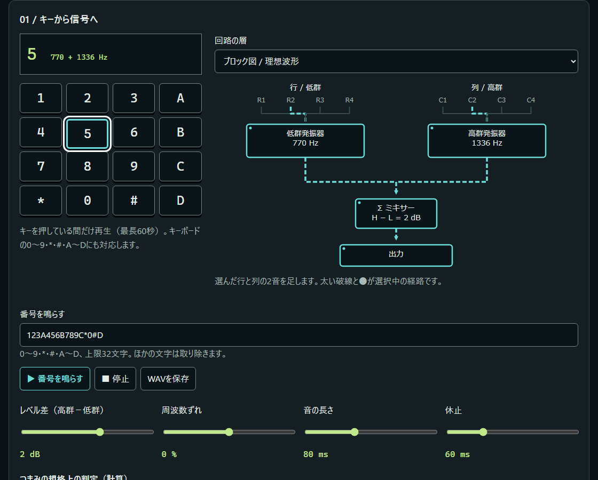
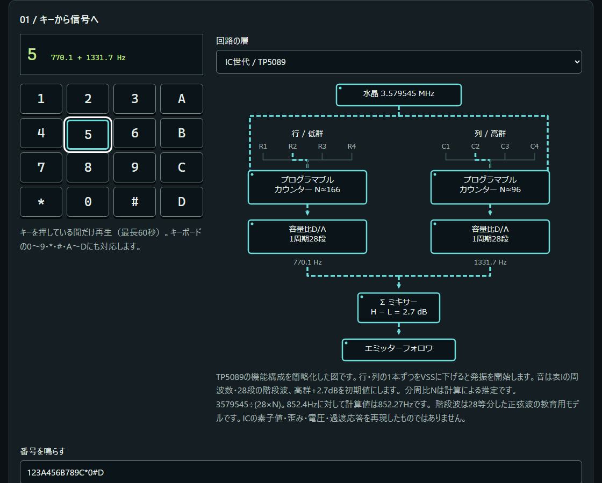
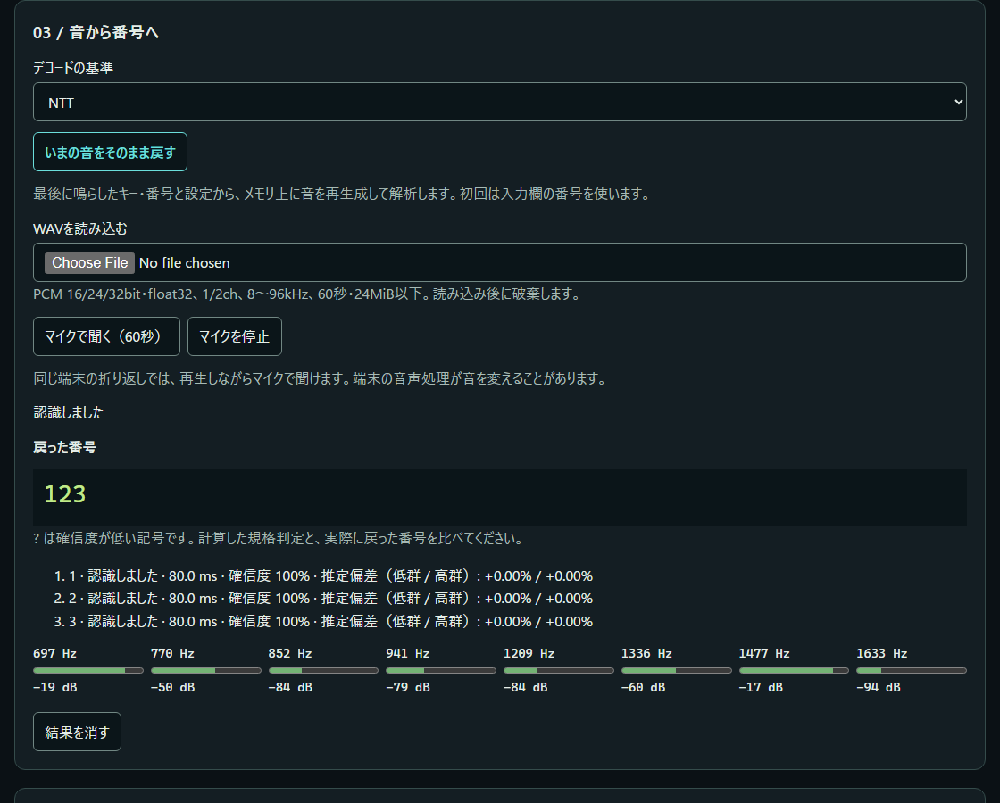
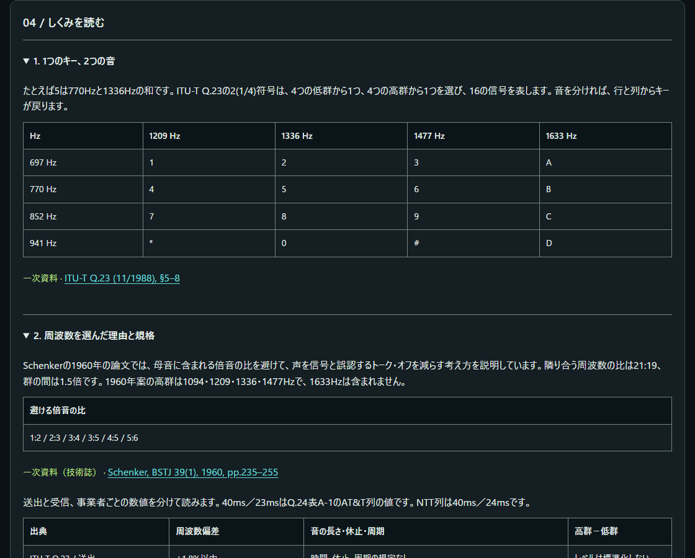

<!--
---
id: day121
slug: dtmfusion

title: "DTMFusion"

subtitle_ja: "電話の音を鳴らし、回路で見て、番号へ戻す"
subtitle_en: "Play telephone tones, trace the circuit, recover the digits"

description_ja: "DTMFの2音を透かし回路・波形・Goertzel解析で学ぶ教材。理想波とTP5089の教育用モデル、規格別の周波数偏差判定を備えます。"
description_en: "Learn DTMF through transparent circuits, waveforms and Goertzel analysis, with ideal tones, a TP5089 teaching model and frequency-offset decisions."

category_ja:
  - 通信技術
  - プライバシー
category_en:
  - Communication Technologies
  - Privacy

difficulty: 2

tags:
  - dtmf
  - goertzel
  - web-audio
  - side-channel
  - electronics

repo_url: "https://github.com/ipusiron/dtmfusion"
demo_url: "https://ipusiron.github.io/dtmfusion/"

hub: true
---
-->

# DTMFusion - 電話の音を鳴らし、回路で見て、番号へ戻す


[](https://ipusiron.github.io/dtmfusion/)

**Day121 - 生成AIで作るセキュリティツール200**

DTMFusionは、電話のキーを2つの音として鳴らし、信号の通り道を回路で見て、音から番号へ戻す教材です。
理想波とTP5089の教育用モデルを切り替え、規格の数値とデコーダーの判定を比べられます。
録音に残った音から番号を復元する側波路の仕組みも扱います。

日本語 / [English](README.en.md)

## 🌐 デモページ

👉 **[DTMFusionを開く](https://ipusiron.github.io/dtmfusion/)**

インストールは不要です。ファイル一式を保存し、`index.html`を直接開いても使えます。
マイクにはブラウザーの許可が必要です。HTTPSまたはlocalhostを推奨します。`file://`でのマイク利用はブラウザーによって異なります。
鳴らす前に端末の音量を小さくし、周りの人やペットに配慮してください。

## 📸 スクリーンショット



キー5を押した経路だけを、太い破線と●で表示します。



IC世代では実周波数と推定分周比を区別して表示します。



番号、認識理由、推定した低群・高群の偏差を表示します。



座学は6節です。数値ごとに一次資料・推定・二次資料を区別します。
ライト版：[ブロック図](assets/block-ja-light.png)／[IC世代](assets/ic-ja-light.png)／[復元](assets/decode-ja-light.png)／[座学](assets/lesson-ja-light.png)。英語版は[英語README](README.en.md#-screenshots)に掲載しています。

## ✨ 機能

- 4×4の16キー。画面またはキーボードで押している間だけ再生（最長60秒）
- 上限32文字の番号列。音80ms・休止60ms・高群+2dBが既定
- レベル差−10〜+10dB、周波数ずれ−5〜+5%、音と休止10〜200msの調整
- 行・列から出力までの透かし回路2層、時間波形、スペクトル、IC世代の28段階段波の拡大
- 最後に鳴らした音の再生成、WAV、マイクの3入力。NTT／AT&Tの受信基準を選択
- 周波数偏差の推定、境界の`?`、認めなかった理由、8周波数のパワー表示
- 本人の操作による番号列のWAV書き出し。日英、ダーク／ライト、動きを減らす設定に対応

## 📐 画面構成

画面は「キーから信号へ」「波形とスペクトル」「音から番号へ」「しくみを読む」の順です。狭い画面ではキーパッドの下に回路を置きます。
波形とスペクトルは選んだキー・設定から作るプレビューで、マイクの実測表示ではありません。波形は12ms、スペクトルは600〜1750Hzの範囲です。
マイクやWAVの解析状況は「音から番号へ」のパワー表示と判定結果で確認します。

## 📖 使い方

1. キー5を押し、770Hzと1336Hzの経路を確認します。キーを離すと音が止まります。
2. 「回路の層」をIC世代へ変え、水晶からカウンター・D/A・ミキサーへの接続を見ます。レベル差の初期値は+2.7dBになります。
3. 「番号を鳴らす」に列を入力します。0〜9・A〜D・*・#以外は入力時に取り除きます。
4. つまみを変え、出典別の規格判定を確認します。「いまの音をそのまま戻す」は最後に鳴らしたキー・列と設定から音を再生成します。初回は入力欄を使います。
5. WAVを選ぶか、「マイクで聞く」で音を解析します。マイクは60秒で止まり、停止・ページ離脱・入力中断時も後始末します。
6. 「WAVを書き出す」で現在の入力列をPCM 16bitとして保存できます。自動保存はしません。

WAV入力はPCM 16/24/32bitまたはfloat32、1/2チャンネル、8〜96kHz、60秒・24MiB以下です。2チャンネルは平均します。
デコード後に読み込んだ音を保持せず、マイクは短い解析窓の値を順に破棄します。残るのは表示中の判定結果です。

## 🎯 ユースケース

このツールならではの使い方

- 情報の授業で、キー5の770Hz＋1336Hz（例E1）から行と列を逆にたどる。4×4＝16通りを8本の周波数で表す構成を説明できる。声の識別器ではない
- 電子工作の学習者が、理想波のキー5をIC世代の770.1Hz＋1331.7Hz（例E2）に変える。公称値・実周波数・分周比の推定を分けて読める。実ICの電圧や素子のシミュレーションではない
- 品質管理の教材で、キー5を+2%ずらすと`?`（例E3）、+3%では拒否（例E4）になることを比べる。「仕様上の境界」と「測定した推定値」を区別できる。製品の合否認証には使えない
- 謎解きの制作者が`123`をWAVにし、読み込んで同じ列へ戻す。音を記号として渡す仕組みを題材にできる。音に残る番号を秘密にする機能はない

授業・家庭での自習、レトロ電子回路の調べもの、録音に含まれる情報の検討にも使えます。
マイクでの結果は部屋、スピーカー、端末の音声処理に左右されます。

以下は48kHz、音80ms、休止60msの例です。`—`は拒否して番号を追加しないことを表します。日英の表をテストで再計算します。

| ID | mode | profile | key | offset % | twist dB | low Hz | high Hz | result |
|---|---|---|---|---|---|---|---|---|
| E1 | ideal | NTT | 5 | 0 | 2 | 770 | 1336 | 5 |
| E2 | ic | NTT | 5 | 0 | 2.7 | 770.1 | 1331.7 | 5 |
| E3 | ideal | NTT | 5 | 2 | 2 | 785.4 | 1362.72 | ? |
| E4 | ideal | NTT | 5 | 3 | 2 | 793.1 | 1376.08 | — |

## 🔬 規格と測定

送出条件と受信条件を分けます。40ms／23msはQ.24表A-1のAT&T列の値であり、ITU-T全体の一律の規定ではありません。
レベル差は高群−低群です。以下は本ツールで扱う項目の抜粋で、規格の全要求を網羅しません。

| 出典 | 周波数偏差 | 音の長さ | 休止 | 周期 | レベル差 |
|---|---|---|---|---|---|
| Q.23 / 送出 | ≤1.8% | 規定なし | 規定なし | 規定なし | 標準化しない |
| Q.24 A-1 / NTT受信 | 動作≤1.8%、不動作≥3.0% | 動作≥40ms、不動作≤24ms | ≥30ms | ≥120ms | −5〜+5dB |
| Q.24 A-1 / AT&T受信 | 動作≤1.5%、不動作≥3.5% | 動作≥40ms、不動作≤23ms | ≥40ms | ≥93ms | −8〜+4dB |
| NTT技術参考資料 / 端末送出 | ≤1.5% | ≥50ms | ≥30ms | ≥120ms | 0〜+5dB |

出典は[Q.23（1988年）](https://www.itu.int/rec/T-REC-Q.23-198811-I/en)、[Q.24（1988年）Annex A](https://www.itu.int/rec/T-REC-Q.24-198811-I/en)、[NTT東日本・第6.2版（2025年7月）p.14](https://flets.com/denwa/gisanshi/pdf/analog_gisanshi.pdf)です。NTTの端末送出の表は1633Hz列を含みません。

解析はHann窓25.6ms、係数を整数ビンへ丸めないGoertzel法です。8本から各群の候補を選び、公称の±4%を0.5%刻みの17点で再計算します。
最大付近の対数パワーを放物線で補間し、同じキーの複数窓を平均して偏差を0.01%単位で判定します。これは表示・判定の刻みであり、精度保証ではありません。
推定したピークのパワーと公称の2位との比は6以上を要求し、レベル差は0.1dB単位です。

| rate Hz | N | rate/N Hz |
|---|---|---|
| 8000 | 205 | 39.02 |
| 44100 | 1129 | 39.06 |
| 48000 | 1229 | 39.06 |

48kHz・16キー・ずれ0%の窓長比較では、群内の比の最小値は20msで理想27.11／IC世代27.10、25.6msで1293.56／1261.38、32msで1413.24／1295.65でした。
25.6msを採用し、比のしきい値6は波形端や瞬断を含む窓の余裕を確保した教育用の設定です。音声全般に対する誤認率の保証ではありません。

2026-10-21の合成音測定では、以下の範囲で全16キーを正しく受理しました。3レート（8k／44.1k／48kHz）で同じ結果でした。
横軸はつまみで加えた偏差です。IC世代では表Iの周波数自体が公称からずれているため、規格の偏差とつまみの値は一致しません。

| mode | profile | 全16キーの受理範囲（%） | 1キー以上の受理範囲（%） |
|---|---|---|---|
| ideal | NTT | -1.8 … +1.8 | -1.8 … +1.8 |
| ideal | ATT | -1.5 … +1.5 | -1.5 … +1.5 |
| ic | NTT | -1.4 … +1.1 | -1.8 … +2.1 |
| ic | ATT | -1.1 … +0.8 | -1.5 … +1.8 |

±5%を0.1%刻みで、16キー×2波形×2基準×3レートの19,392通りを調べ、別のキーへ戻ったものは0件でした。
推定偏差の絶対値がNTTの3.0%／AT&Tの3.5%以上なら「周波数ずれ」で拒否します。動作値1.8%／1.5%を超え、不動作値未満なら「境界」の`?`です。
理想波の全16キー・3レートで、動作値と不動作値ちょうど、およびその隣の0.1%を回帰テストにしています。
詳細な数値は[測定データ](docs/measurements.json)にあります。受信の周期条件と声の誤認を減らす2倍音の検査は未実装です。
つまみ横の規格判定は設定値からの計算、復元結果は音からの推定であり、同一の判定ではありません。

## 📚 回路と座学の出典

- [TP5089データシート](https://pf.unikeyic.com/datasheet/43/7d/d1e0/437dd1e00336b1f0b5169f5d864a3432.pdf)：一次資料のミラー。水晶3.579545MHz、プログラマブルカウンター、容量比D/A、ミキサー、エミッターフォロワを表示。音は表Iの実周波数を使用
- 分周比N＝184/166/150/136・106/96/86/78：計算による推定。データシート記載値ではない。3579545÷(28×150)＝852.27Hzに対し、表Iは852.4Hz。波形も28等分した正弦波の教育用モデルであり、実ICの素子値・電圧・過渡応答を再現しない
- [Schenker（1960年）](https://www.repeater-builder.com/tech-info/dtmf/pdfs/bstj-39-01-pages-235-255.pdf)：一次資料（技術誌）。隣接周波数比21:19、群間1.5倍、母音の倍音比を避ける設計。1960年案の高群は1094/1209/1336/1477Hzで、1633Hzは含まない
- [Gorgas、Bell Labs Record（1968年4月）](https://www.telephonecollectors.info/index.php/browse/document-repository/catalogs-manuals/bell-system-we/bell-labs-record/11826-68apr-blr-p106-autovon/file)：一次資料。AUTOVONのFO・F・I・Pと、ボタンのないRoutine。1633Hz列との対応は[Crypto Museum](https://www.cryptomuseum.com/phone/autovon/index.htm)などの二次資料による
- [PCI SSC v3.0（2018年11月）](https://listings.pcisecuritystandards.org/documents/Protecting_Telephone_Based_Payment_Card_Data_v3-0_nov_2018.pdf)：業界標準団体の一次資料。2018年版でのSAD（機密認証データ）、suppression、masking、DTMF bleedを扱う。SADをカード番号全体と同一視せず、最新版の適合判定は扱わない

## 🔄 先行例との違い

[DTMF_Codec](https://github.com/unfantasmaenelsistema/DTMF_Codec)は、16キーの生成、WAV書き出し、ファイル・マイクからの復元を備える先行例です。
比較は2026-10-21の調査に基づきます。未記載の機能がないことまでは断定しません。

| 観点 | DTMF_Codec | DTMFusion |
|---|---|---|
| 生成と復元 | Goertzel窓25ms、±1.5%、ツイスト判定 | 窓25.6ms、偏差推定、NTT／AT&Tの切替 |
| 見せ方 | 表・ボタンが中心。透かし回路の記載は確認できず | 行列→2音→加算、TP5089の2層と選択経路 |
| 文脈と言語 | CTF向け、西英 | 側波路・規格・回路史の座学、日英 |

## 🔒 安全対策と限界

音の生成・解析は端末内で処理します。音や番号を外へ送りません。マイクを録音・保存せず、WAV書き出しは本人の操作時だけです。
保存する設定は言語と明暗だけです。生成時の合計振幅は−12dBFS以下で、前後2msにランプを設けています。dBFSは端末から出る音圧を表す単位ではありません。

CSPは次のままで、WAV書き出しのための追加はありません。

```text
default-src 'none'; script-src 'self'; style-src 'self'; img-src 'self' data:; base-uri 'none'; form-action 'none'; frame-src 'none'; object-src 'none'; connect-src 'none'
```

インラインスクリプト・イベントハンドラー・style属性、外部ライブラリ・フォントは使いません。文字列は安全なDOM操作で挿入し、`referrer=no-referrer`を指定しています。
明暗双方の文字コントラストを検査し、色だけで経路・結果を伝えず、動きを減らす設定では静止表示にします。

この教材は規格準拠の受信機ではなく、確信度も統計的な正解確率ではありません。実機のスピーカー→マイク、別端末・電話機、Safari実機は未検証です。
Firefoxで同じ端末の再生音をマイクへ戻す際の音声処理や、iOSの音声経路の変化によって結果が変わり得ます。
作者IPUSIRONはセキュリティ分野の技術書の著者です。作者は悪用を勧めません。

## 🔗 関連ツール

- [Day120 Airborne Tone Link](https://ipusiron.github.io/airborne-tone-link/)：2本のトーンで1バイトを表す教材。DTMFと同じ発想を別の符号へ広げる例。音の生成・入出力処理の手本（同じ作者のMITコード）
- [Day041 Mic Gain Logger](https://ipusiron.github.io/mic-gain-logger/)：マイク入力の帯域を監視するツール。部屋や端末の入力状態を調べるときの関連教材

## 🧪 テスト

Node.js 22以上で、依存パッケージの追加なしに実行できます。

```sh
npm test
node --test test/frequency.test.js
```

GitHub Actionsのpushとpull_requestで構文検査と全テストを実行します。表・16キーの往復・ゲイン・時間・雑音・周波数偏差・WAV・音声の停止処理・CSP・日英辞書・コントラスト・READMEの数値を検証します。
ブラウザー確認はHTTP／`file://`、Chromium／Firefox、320／390／1280px、日英、明暗、回路2層の96条件で実施しました。
OfflineAudioContextで3レート×2波形×2基準の12通り、生成したWAVを仮想マイクへ入れた`123*#`の復元も確認しています。これらは実機音響試験の代わりにはなりません。

## 📁 ディレクトリー構造

```text
dtmfusion/                     # ツール一式
├── .github/                   # GitHub設定
│   └── workflows/             # CI
│       └── test.yml           # Node 22で構文検査とテスト
├── .gitattributes             # 改行の規則
├── .gitignore                 # 作業用・バックアップの除外
├── index.html                 # 1枚の画面とCSP
├── style.css                  # 明暗・レスポンシブ表示
├── messages.js                # 日英の全文言
├── dtmf-core.js               # 純粋な生成・解析・規格判定
├── audio-io.js                # 再生・マイクと終了処理
├── app.js                     # DOM・回路・波形・座学
├── package.json               # 依存なしのテスト定義
├── LICENSE                    # MIT License
├── CLAUDE.md                  # 開発・検証の案内
├── README.md                  # 日本語の案内
├── README.en.md               # 英語の案内
├── docs/                      # 再測定の結果
│   └── measurements.json      # 全条件の範囲と窓長比較
├── assets/                    # 実画面のPNG
│   ├── block-ja-dark.png      # ブロック図・日本語・暗
│   ├── block-ja-light.png     # ブロック図・日本語・明
│   ├── block-en-dark.png      # ブロック図・英語・暗
│   ├── block-en-light.png     # ブロック図・英語・明
│   ├── ic-ja-dark.png         # IC世代・日本語・暗
│   ├── ic-ja-light.png        # IC世代・日本語・明
│   ├── ic-en-dark.png         # IC世代・英語・暗
│   ├── ic-en-light.png        # IC世代・英語・明
│   ├── decode-ja-dark.png     # 復元・日本語・暗
│   ├── decode-ja-light.png    # 復元・日本語・明
│   ├── decode-en-dark.png     # 復元・英語・暗
│   ├── decode-en-light.png    # 復元・英語・明
│   ├── lesson-ja-dark.png     # 座学・日本語・暗
│   ├── lesson-ja-light.png    # 座学・日本語・明
│   ├── lesson-en-dark.png     # 座学・英語・暗
│   └── lesson-en-light.png    # 座学・英語・明
└── test/                      # node:test
    ├── core.test.js           # 表・生成・復元・規格境界
    ├── frequency.test.js      # 偏差と誤復号の回帰
    ├── audio.test.js          # 音声資源の終了処理
    ├── wav.test.js            # WAVと不正入力
    ├── structure.test.js      # CSP・辞書・配色・形式
    └── readme.test.js         # 日英READMEの表・構造・画像
```

## 💻 動作環境

Web Audio APIに対応するブラウザーを使用します。ChromiumとFirefoxのHTTP／`file://`で確認しています。マイクはHTTPSまたはlocalhostを推奨します。
ローカルHTTPで開く場合は、ツールのフォルダーで次を実行し、`http://127.0.0.1:8000/`を開きます。

```sh
python -m http.server 8000 --bind 127.0.0.1
```

## 📄 ライセンス

MIT License。詳しくは[LICENSE](LICENSE)を参照してください。外部依存パッケージはありません。
図は出典の機能構成をもとに作成した教育用の図です。

## 🛠️ このツールについて

本ツールは、「生成AIで作るセキュリティツール200」プロジェクトの一環として開発されました。
このプロジェクトでは、AIの支援を活用しながら、セキュリティに関連するさまざまなツールを100日間にわたり制作・公開していく取り組みを行っています。

プロジェクトの詳細や他のツールについては、以下のページをご覧ください。

🔗 [生成AIで作るセキュリティツール200](https://akademeia.info/?page_id=44607)
